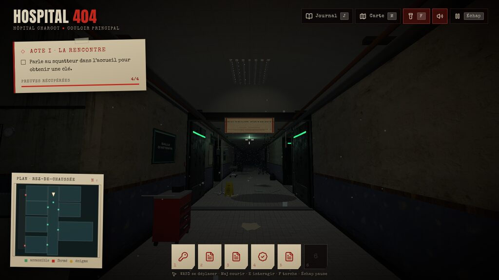

# HOSPITAL 404 — Hôpital Charcot

Jeu d'horreur et d'enquête en vue subjective, en 3D dans le navigateur. Thomas Vasseur entre de nuit dans l'hôpital Charcot, abandonné, pour retrouver le dossier de sa mère Éléonore. Il a 30 minutes pour résoudre quatre énigmes, découvrir la vérité et s'enfuir.



## Titre et équipe

| | |
|---|---|
| Jeu | **HOSPITAL 404 — Hôpital Charcot** |
| Code de l'équipe | MRS-C Hostpital 404 |
| Nom de l'équipe | Groupe C |
| Campus | Marseille |

| Membre | Rôle |
|---|---|
| Carla | Chef de Projet |
| Lucas.J | Développeur Gameplay & Scénariste |
| Mohamed | Lead Développeur & Intégrateur |
| Lokman | Développeur Gameplay & Game Designer |
| Lucas.L | Développeur UI & Graphiste |
| Dan | Développeur Audio & Passation |

## Jouer en 2 minutes

**En ligne, rien à installer :** <https://hospital404-react3d.vercel.app/>

1. Ouvrir l'adresse dans **Chrome** ou **Edge** (conseillés), ou Firefox, sur ordinateur.
2. Attendre la fin de la barre de chargement (environ 55 Mo la première fois).
3. Cliquer sur **NOUVELLE PARTIE**, choisir la difficulté, puis cliquer dans la scène pour prendre la souris.
4. Mettre un casque : le son fait partie du jeu.

**Sans Internet, depuis le ZIP** (Node.js 20.19+ ou 22+ requis) :

1. Télécharger le ZIP du dépôt et le décompresser.
2. Windows : double-cliquer sur **`lancer-windows.bat`**. macOS / Linux : dans le dossier, lancer `npm install` puis `npm run dev`.
3. Ouvrir <http://localhost:5173>.

**Configuration minimale :** ordinateur avec WebGL 2 et accélération matérielle activée, 8 Go de RAM, écran 1280 × 720, clavier et souris (une manette fonctionne aussi). La qualité est choisie automatiquement selon la carte graphique et s'abaisse d'elle-même si le jeu rame ; sur une très petite machine, la qualité « Minimale », une résolution de rendu réduite et la limite à 30 images par seconde (Réglages) le rendent jouable. Le jeu se lance aussi sur téléphone récent, en paysage, avec des commandes tactiles.

## Comment jouer

### But du jeu

Avancer d'acte en acte dans l'hôpital : parler au squatteur, retrouver la chambre d'Éléonore, puis résoudre les énigmes de la radiologie, de la sécurité et du laboratoire. À la morgue, la clé USB révèle la vérité, et le monstre se réveille : il faut fuir par le passage secret jusqu'à l'entrée avant qu'il ne vous attrape. On peut se cacher dans certains casiers et sous certains lits.

### Commandes

| Action | Clavier / souris | Manette |
|---|---|---|
| Se déplacer | **ZQSD** (AZERTY), **WASD** (QWERTY) ou flèches | Stick gauche |
| Regarder | Souris (cliquer d'abord dans la scène) | Stick droit |
| Courir | Maj | Gâchette |
| Sauter | Espace | B |
| Interagir, parler, examiner, se cacher | E | A |
| Lampe torche | F | X |
| Journal / Inventaire / Carte | J / I / M | Y / — / Select |
| Pause, fermer une fenêtre | Échap | Start |

Sur téléphone : pouce gauche pour marcher (joystick), pouce droit pour regarder, boutons à l'écran pour interagir, sauter et allumer la lampe.

Dans l'inventaire (I), la **fiche patiente 203** et le **rapport H-404** s'ouvrent d'un clic pour être lus.

### Chronomètre

- La partie dure **30 minutes**, affichées en haut de l'écran. Le temps tourne aussi pendant les dialogues et les énigmes, et s'arrête en pause.
- Alertes à 5 minutes et à 1 minute. À zéro, c'est la fin tragique.
- **Pénalités : −1 minute** pour chaque screamer subi, chaque mauvaise réponse et chaque indice demandé. Une mauvaise réponse ne coûte qu'une minute, screamer compris. Un champ vide ne coûte rien.
- Une partie réussie est classée sur le temps utilisé, pénalités comprises (classement local et classement en ligne).

### Indices

- Chaque énigme affiche des notes gratuites (l'énoncé et ses données).
- Le bouton **DEMANDER UN INDICE** révèle deux ou trois indices progressifs, un par un, pour 1 minute chacun.
- Plus aucun indice n'est proposé quand il reste moins d'une minute.

### Difficulté

Facile, Normale ou Difficile, au lancement d'une nouvelle partie. Elle règle le monstre, l'endurance et la fréquence des screamers. Le chronomètre et les pénalités sont les mêmes partout.

## Solution complète

| Acte | Lieu | Énigme | Solution | Comment l'entrer |
|---|---|---|---|---|
| I | Accueil | Le squatteur | Lui parler : il donne la clé du secteur des patients | E face au squatteur, puis E pour faire défiler le dialogue |
| II | Chambres 201–204 | Quatre chambres, quatre patients (logique) | **203** — Bernard est en 202, Laurent en 204, Éléonore n'est ni en 201 ni en 204 et son numéro est supérieur à 202 | E sur le tiroir sécurisé de la chambre 203, taper `203`, VALIDER |
| III | Radiologie | L'équation du médecin | 3(2X − 4) + 5 = 29 → 6X = 36 → **X = 6** ; 6 × 4 = 24 → **0024** | E sur le coffre du bureau, taper `0024`, VALIDER |
| IV | Sécurité | Le planning de maintenance | Chemin critique **A → B → D** = 2 + 3 + 1 = **6 heures** → **0600** | E sur le terminal de sécurité, taper `0600`, VALIDER |
| V | Laboratoire | HOSPITAL DATABASE (SQL) | `SELECT * FROM patients WHERE nom = 'Vasseur' AND prenom = 'Eleonore' AND annee_deces = 2018;` | E sur le terminal, taper la requête, VALIDER. Majuscules, accents, ordre des conditions et point-virgule final sont tolérés |
| VI | Morgue | La clé USB | Ramasser la clé **BACKUP_H404_FINAL** : la vidéo révèle que le squatteur est Adrien Vasseur | E sur la clé USB |
| Final | Galerie secrète → entrée | La fuite | Courir par le passage secret jusqu'à l'entrée sans se faire attraper ; se cacher si le monstre est trop près | Déplacement libre ; E pour se cacher ou sortir d'une cachette |

Fin : **SAD END — Le dernier patient**.

## Comptes de test

Aucun compte n'est nécessaire. Le classement en ligne demande seulement un prénom et un nom en fin de partie, affichés publiquement : utiliser par exemple `Test` / `Jury`. Aucun mot de passe n'existe dans le jeu.

## Technologies

| Élément | Version |
|---|---|
| JavaScript (ES modules), JSX, HTML, CSS | — |
| React / React DOM | 19 |
| Three.js (moteur 3D WebGL) | 0.180 |
| React Three Fiber | 9.8 |
| Drei | 10.7 |
| postprocessing / @react-three/postprocessing | 6.39 / 3.2 |
| Zustand (état du jeu) | 5.0 |
| Vite (compilation, serveur de développement) | 6.4 |
| lucide-react (icônes d'interface) | 0.468 |
| Web Audio API (sons, spatialisation, synthèse) | navigateur |
| Vercel Functions + Neon PostgreSQL (`@neondatabase/serverless` 1.2) | classement en ligne |
| Node.js test runner, Playwright 1.56, PGlite | tests |

## Structure du dépôt

```text
├── index.html, vite.config.js, package.json
├── lancer-windows.bat     installation et lancement en un double-clic (Windows)
├── api/                   fonctions Vercel du classement en ligne (run.js, scores.js)
├── public/
│   ├── assets/models/     modèles 3D GLB (Draco + WebP)
│   ├── assets/textures/   textures PBR WebP
│   ├── assets/sounds/     ambiance, pas, effets, musique, screamers
│   ├── assets/voices/     voix des personnages
│   ├── assets/items/      images des objets d'inventaire et contenu des documents
│   ├── assets/scare/      images des screamers
│   ├── assets/signs/      panneaux de signalétique
│   ├── draco/             décodeur Draco local
│   └── menu/              vidéo et visuels du menu principal
├── src/
│   ├── App.jsx, main.jsx, styles.css, phone.css
│   ├── components/        scène 3D (World, Props, Furniture, Player, Character…) et interface (HUD, TouchControls, Leaderboard)
│   └── game/              logique : plan, scénario, énigmes, progression, sauvegarde, audio, monstre, chronomètre, tests
├── scripts/               vérifications automatiques dans le navigateur (Playwright) et préparation des modèles
└── docs/                  scénario officiel, ASSETS.md, IMPLEMENTATION.md, VOIX.md, AFFICHES.md, captures
```

## Lancer en développement

Prérequis : Node.js 20.19+ ou 22+ (testé avec Node 24), npm. Aucune variable d'environnement n'est nécessaire en local : le classement utilise une base en mémoire.

```bash
npm install
npm run dev          # http://localhost:5173
npm test             # tests Node (plan, collisions, énigmes, sauvegarde, classement…)
npm run build        # version de production dans dist/
npm run preview      # sert dist/
npm run check:all    # tests, build et parcours complet dans Chromium
```

Les vérifications navigateur demandent une fois `npx playwright install chromium`. En production (Vercel), le classement lit `DATABASE_URL` (Neon) et, en option, `LEADERBOARD_SECRET`.

Détails techniques et historique des choix : [`docs/IMPLEMENTATION.md`](docs/IMPLEMENTATION.md).

## Crédits et licences

Voir **[LICENCES.md](LICENCES.md)** : licence du code, ressources CC0 et CC BY (crédits obligatoires), et ressources dont la licence reste à confirmer. Liste détaillée, ressource par ressource : [`docs/ASSETS.md`](docs/ASSETS.md).

## IA

Voir **[REGISTRE_IA.md](REGISTRE_IA.md)** : outils d'IA utilisés, pour quoi faire, et ce qui a été vérifié à la main.

## Limites connues

- **Testé surtout sur ordinateur Apple Silicon** avec Chrome. Le parcours téléphone n'est vérifié qu'en émulation : fluidité, chauffe et mémoire restent à constater sur de vrais appareils, surtout iPhone (Safari).
- **Premier chargement lourd** (environ 55 Mo) et pas de cache hors ligne. Sur téléphone, la page peut recharger si la mémoire manque : garder la qualité « Basse » ou « Minimale ».
- **Licences à confirmer** pour quelques fichiers fournis par l'équipe (musique, rire, screamers, lampe torche, certains objets 3D) : voir LICENCES.md. Le rire vient a priori d'une œuvre protégée et doit être remplacé avant toute diffusion publique.
- **Classement en ligne** : un tricheur motivé peut annoncer un faux temps plausible, car le chronomètre tourne dans le navigateur.
- **Polices web** chargées depuis Google Fonts : hors ligne, des polices système les remplacent.
- **Prévu mais non fait** : quêtes secondaires et succès (`quete secondaire et succes.pdf`), plafonds et matériaux plus variés selon les salles, lumière indirecte précalculée, chargement progressif par pièce.
